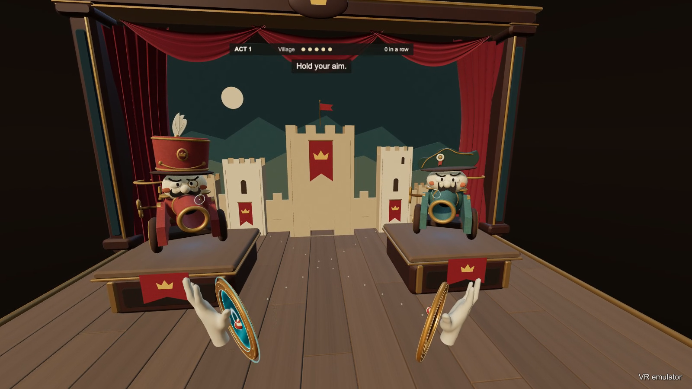

# Return to Sender | A Tabletop VR Game

**Live demo: [sender.play.thomasou.com](https://sender.play.thomasou.com/)**

Catch a cannonball with one palm portal and send it back through the other. Two toy cannons, a wooden theater, and a village to defend across three acts.

[Watch the gameplay demo](https://www.youtube.com/watch?v=w1YremU_ohs) · [Devpost entry](https://devpost.com/software/return-to-sender-5ci07b)



## Quick Start

Use Node.js 22.12+ within the 22.x release line, or Node.js 24+.

```sh
git clone https://github.com/Smokeybear10/305.GAME.return-to-sender.git
cd 305.GAME.return-to-sender
ONNXRUNTIME_NODE_INSTALL_CUDA=skip npm ci
npm run dev
```

Open https://localhost:8089. The IWSDK development server launches a browser with its immersive-session emulator. The install setting skips an unused CUDA download in the SDK tooling; the game needs no API keys.

```sh
npm run typecheck
npm run build
```

## What It Does

**Palm portals**

- Either hand can catch a shot while the other aims its return.
- A pale marker shows the incoming shot's path; a dotted line shows the return direction.
- Raising both hands starts or restarts play. Losing hand tracking pauses the game.

**Three acts**

- Start with a slow practice shot, then work around a protective shutter.
- In the finale, the cannons alternate fire while cover switches sides.
- Chain hits to build a streak, save your personal best locally, and finish without village damage for Perfect Defense.

**Controls**

| Input | Action |
| --- | --- |
| VR hands | Move and rotate your palms to catch and aim |
| Mouse movement | Aim the selected portal |
| Drag either portal | Move it across the stage |
| Q / E | Select the left / right portal |
| Scroll or arrow up / down | Adjust portal depth |
| Space | Pause or resume |
| R | Restart |

## Tech Stack

| Layer | Tools |
| --- | --- |
| Game | TypeScript, Meta Immersive Web SDK (IWSDK) |
| Rendering | Three.js, procedural models and textures |
| Input | WebXR hand tracking, mouse and keyboard |
| Audio | Web Audio, recorded cannon voices |
| Build | Vite |

## Project Structure

```text
src/game.ts             # Game loop, scoring, and act progression
src/hand-input.ts       # Palm tracking and portal control
src/art/                # Theater, cannons, portals, and aiming cues
src/sound.ts            # Effects and cannon voices
public/audio/           # Runtime voice clips
public/scenes/          # Scene composition
iwsdk.config.json       # Scene, world features, and emulator profile
```

## Validation

All three acts have been completed in desktop and IWSDK browser-emulator runs with eight hits and all five village lives remaining. The demo uses the Quest 3 emulator profile with simulated hand and head movement. Physical Quest testing is still pending.

Third-party license notices are in [THIRD-PARTY-NOTICES.txt](THIRD-PARTY-NOTICES.txt).

Built by Thomas Ou
